  

  
  
  

### ⊢ About

I'm a Computer Science student in China who builds software end to end: Windows system tools in Rust, full-stack web platforms in TypeScript, mobile apps in Flutter, and trading and machine-learning systems in Python and MQL5. I care about software that is fast, tested and handed over properly.

I run a small software studio alongside my studies, building products for clients and our own. **I'm open to software engineering roles and internships.**

### ⊢ Selected work

| Project | What it is | Built with | Proof |
|---|---|---|---|
| [**GATES**](https://axiom-engineering-studio.vercel.app/projects/gates-focus-enforcement) | A focus blocker for Windows that enforces inside the OS (process suspension, AppLocker, hosts file, DNS and firewall) and restores everything when a session ends. | Rust · Tauri 2 · React · SQLite · Win32 | 167 Rust unit tests, ~30K lines |
| [**AfriConnect Professionals**](https://axiom-engineering-studio.vercel.app/projects/africonnect-professionals) | A curated dating platform for African professionals, built for a client from tender to MVP. One typed API serves a web portal and a native app. | Next.js · Express · Prisma · PostgreSQL · Flutter | 16 API modules, 45 test suites |
| [**Multi-Strategy Trading Engine**](https://github.com/magmastormy/metatrader-multistrategy-ea) | An autonomous MetaTrader 5 system: 20 strategies vote before any order, behind one risk gate no strategy can bypass. ML signals can run alone or alongside. | MQL5 · Python · ML | 20 strategy modules, 5 asset classes |
| [**Mutapa ZimPay**](https://axiom-engineering-studio.vercel.app/projects/mutapa-zimpay) | A mobile wallet for Zimbabwe with USD and ZiG balances, built on a server-side double-entry ledger with idempotent transfers. | Flutter · Dart · Riverpod | 16 features specified, STRIDE threat model |
| [**BCF Scholars Platform**](https://axiom-engineering-studio.vercel.app/projects/bcf-scholars-platform) | Public site, online applications and staff back office for a scholarship agency, with the public pages on a read-only database role. | Next.js · TypeScript · Prisma · PostgreSQL | 30 data models |
| [**Architect Pro**](https://axiom-engineering-studio.vercel.app/projects/architect-pro) | An AI diagram studio: plain language or broken diagram code in, an editable architecture diagram out, with an automatic repair loop. | React · Express · LLM API · Mermaid | 30+ diagram languages |

Most client and product code is private; each link above opens the case study. Public code: <a href="https://github.com/magmastormy/metatrader-multistrategy-ea">metatrader-multistrategy-ea</a> · <a href="https://github.com/magmastormy/coinDrop-walletFrame-FinanceManagement">coinDrop</a> · <a href="https://github.com/magmastormy/Farm-Management-PWA">Farm-Management-PWA</a> · <a href="https://github.com/magmastormy/CampusGoodTradingPlatform_Wenzhou-University">CampusGoodTradingPlatform</a> · <a href="https://github.com/magmastormy/ProductivePulse_WebDevelopment_WenzhouUniversity">ProductivePulse</a>

### ⊢ Toolbox

**Languages**
 

**Frameworks and platforms**
 

**Data and infrastructure**
 

### ⊢ How I work

- **Tested before it ships.** Unit tests on the core logic, type checks and a production build on every change.
- **Built to be handed over.** Clear structure, written decisions, and docs a new engineer can pick up.
- **Security from day one.** Threat models before features on payment work, least-privilege database roles, no secrets in code.

### ⊢ Get in touch

The fastest way to reach me is through the [studio contact page](https://axiom-engineering-studio.vercel.app/contact). I reply within a day.

⊢ built to last

