  

  
  
  

### ⊢ About

I'm a software engineer and a **Master's student in Artificial Intelligence at Nanjing University of Posts and Telecommunications (NJUPT)**, with a **BEng in Computer Science from Wenzhou University**.

I build software end to end: Windows system tools in Rust, full-stack platforms in TypeScript, mobile apps in Flutter, and trading and machine-learning systems in Python and MQL5. Alongside my studies I run a small software studio that builds products for clients and for ourselves. I care about software that is fast, tested, and handed over properly.

**I'm open to software engineering and AI/ML roles and internships.**

  

### ⊢ Selected work

  
  

  
  

  
  

Each card opens its case study. Most client and product code is private; public code: <a href="https://github.com/magmastormy/metatrader-multistrategy-ea">metatrader-multistrategy-ea</a> · <a href="https://github.com/magmastormy/coinDrop-walletFrame-FinanceManagement">coinDrop</a> · <a href="https://github.com/magmastormy/Farm-Management-PWA">Farm-Management-PWA</a> · <a href="https://github.com/magmastormy/CampusGoodTradingPlatform_Wenzhou-University">CampusGoodTradingPlatform</a> · <a href="https://github.com/magmastormy/ProductivePulse_WebDevelopment_WenzhouUniversity">ProductivePulse</a>

  

### ⊢ How I work

- **Tested before it ships.** Unit tests on core logic, type checks and a production build on every change. GATES alone carries 167 Rust unit tests.
- **Built to be handed over.** Clear module boundaries, written decisions, and docs a new engineer can pick up on day one.
- **Secure from the first commit.** Threat models before features on payment work, least-privilege database roles, no secrets in code.

### ⊢ Get in touch

The best way to reach me is the [contact page on my studio site](https://axiom-engineering-studio.vercel.app/contact). I reply within a day.

⊢ built to last

